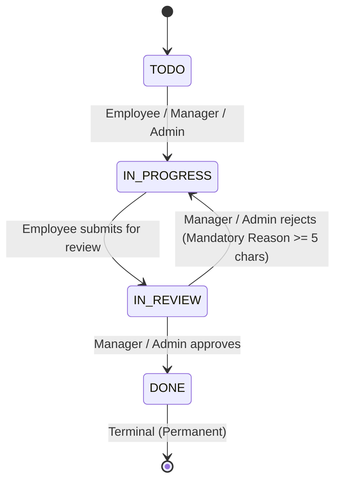

# Actowiz Task Management System — REST API & WebSocket Specification

## 1. Global Standards & Architectural Conventions

### 1.1 Base URL & Environment Ports
- **REST Base URL**: `http://localhost:5000/api` (Production: `/api` via Nginx reverse proxy)
- **WebSocket Gateway**: `http://localhost:5000/socket.io`
- **Frontend SPA**: `http://localhost:5173` (Docker: `http://localhost:80` and `http://localhost:5173`)
- **Database**: MongoDB 7.0 Replica Set on `mongodb://localhost:27017/actowiz_task_manager`

---

### 1.2 Security & Headers

#### Authentication
- **HttpOnly Cookies**: Session tokens are transmitted exclusively in secure cookies.
  - `access_token`: Short-lived JWT (15 minutes). Contains `{ _id, email, role, teamId }`.
  - `refresh_token`: Long-lived cryptographic token (7 days). Stored hashed (SHA-256) in MongoDB (`RefreshToken` collection) with device/IP tracking and absolute revocation support.
- **Cookie Security Flags**:
  - `HttpOnly: true` (Prevents client-side XSS extraction).
  - `SameSite: 'lax'` (or `'none'` when cross-origin HTTPS is configured).
  - `Secure: true` in production environments.

#### CSRF Defense
- All state-mutating requests (`POST`, `PATCH`, `PUT`, `DELETE`) are protected by the centralized `csrfProtection` middleware.
- Requests must include the custom header:
  ```http
  X-Requested-With: XMLHttpRequest
  ```
- Alternatively, incoming requests must provide an `Origin` or `Referer` header strictly matching the configured `CLIENT_URL`.

#### Rate Limiting
- **Authentication (`/api/auth/login`)**: Max 10 requests per 15-minute window per IP. Exceeding returns `429 Too Many Requests`.
- **General API**: Max 200 requests per minute per IP.
- Rate limiting headers are included in all responses:
  - `RateLimit-Limit`
  - `RateLimit-Remaining`
  - `RateLimit-Reset`

#### Date Validation Policy
- **Past Dates Prohibited**: Task due dates (`dueDate`) and Project start/end dates (`startDate`, `endDate`) strictly reject past dates.
- **Timezone Accommodating**: The validation engine accommodates global time zones up to `UTC-12` so users selecting "today" in any worldwide timezone are never rejected.

---

### 1.3 Standard Response & Error Envelopes

#### Success Envelope (`200 OK`, `201 Created`)
```json
{
  "success": true,
  "data": { ... },
  "meta": {
    "page": 1,
    "limit": 50,
    "total": 120,
    "totalPages": 3,
    "unreadCount": 4
  }
}
```

#### Error Envelope (`400`, `401`, `403`, `404`, `409`, `429`, `500`)
```json
{
  "success": false,
  "error": {
    "code": "VALIDATION_ERROR",
    "message": "Validation failed",
    "details": [
      {
        "field": "rejectionReason",
        "message": "Rejection reason must be at least 5 characters"
      }
    ]
  }
}
```

---

## 2. Role-Based Access Control (RBAC) Matrix

| Resource & Operation | Admin | Manager | Employee | Notes |
|---|:---:|:---:|:---:|---|
| **Health Check** (`GET /api/health`) | Public | Public | Public | System status |
| **Login / Refresh** (`POST /api/auth/*`) | Public | Public | Public | Credentials / Cookies |
| **Logout** (`POST /api/auth/logout`) | Yes | Yes | Yes | Revokes DB session |
| **Profile** (`GET /api/auth/me`) | Yes | Yes | Yes | Active user only |
| **Manage Users** (`/api/users/*`) | Full | No | No | System-wide user administration |
| **Manage Teams** (`/api/teams/*`) | Full | View Own | No | Team creation, members, managers |
| **List Projects** (`GET /api/projects`) | All | Own Team / Managed | Assigned Tasks | Scoped automatically |
| **Create Project** (`POST /api/projects`) | Any Team | Own Team | No | Validates dates and team |
| **Edit Project** (`PATCH /api/projects/:id`) | All | Managed Projects | No | Cannot edit if archived |
| **Delete Project** (`DELETE /api/projects/:id`) | Yes | No | No | Deletes child tasks & files |
| **List Tasks** (`GET /api/tasks`) | All | Managed Projects / Team | Assigned Only | Cross-team isolation |
| **Create Task** (`POST /api/tasks`) | Any Team | Managed Projects | No | Team & project consistency |
| **Edit Task Details** (`PATCH /api/tasks/:id`) | All | Managed Projects | No | Blocked if project archived |
| **Delete Task** (`DELETE /api/tasks/:id`) | All | Managed Projects | No | Cleans activities/comments |
| **Start Work** (`TODO -> IN_PROGRESS`) | Yes | Yes | Assigned Only | |
| **Submit Review** (`IN_PROGRESS -> IN_REVIEW`) | Yes | Yes | Assigned Only | Dispatches review alerts |
| **Approve Task** (`IN_REVIEW -> DONE`) | Yes | Managed Projects | No | Terminal permanent state |
| **Reject Review** (`IN_REVIEW -> IN_PROGRESS`) | Yes | Managed Projects | No | Mandatory `>= 5` char reason |
| **Task CSV Export** (`GET /api/tasks/export/csv`) | Scoped | Scoped (Own Team) | Scoped (Assigned) | Formula injection sanitized |
| **Upload Attachment** (`POST /tasks/:id/attachments`) | Yes | Managed Projects | Assigned Task | Binary magic-bytes verified |
| **Delete Attachment** (`DELETE /tasks/:id/attachments/:id`) | Yes | Managed Projects | Uploader Only | Employees cannot delete others' |
| **Comments** (`/api/tasks/:id/comments`) | Full | Managed Projects | Assigned Task | Triggers notifications |
| **Activity Trail** (`GET /api/tasks/:id/activity`) | Full | Managed Projects | Assigned Task | Append-only server audit |
| **Notifications** (`/api/notifications/*`) | Own | Own | Own | Private per-user alerts |
| **Dashboard Stats** (`GET /api/dashboard/stats`) | Global | Team/Managed | Assigned Only | Dynamically calculated |

> [!NOTE]
> **IDOR & Cross-Team Defense**: Attempting to view or access resources outside an actor's permitted team or assignment returns a clean `404 Not Found` rather than leaking resource existence.

---

## 3. Endpoints Documentation

### 3.1 System & Health

#### `GET /api/health`
Health check endpoint to verify server responsiveness.
- **Access**: Public
- **Headers**: None
- **Response `200 OK`**:
  ```json
  {
    "success": true,
    "status": "healthy",
    "timestamp": "2026-11-05T01:00:00.000Z"
  }
  ```

---

### 3.2 Authentication & Session Management

#### `POST /api/auth/login`
Authenticates a user, creates a database session with device/IP tracking, and issues cookies.
- **Access**: Public
- **Rate Limit**: 10 attempts / 15 minutes
- **Headers**: `Content-Type: application/json`, `X-Requested-With: XMLHttpRequest`
- **Request Body**:
  ```json
  {
    "email": "sarah.admin@actowiz.com",
    "password": "AdminPass123!"
  }
  ```
- **Validation**:
  - `email`: Valid email format, lowercase normalized.
  - `password`: String, min 1 character.
- **Response `200 OK`**:
  - Sets `Set-Cookie`: `access_token=...; HttpOnly; SameSite=Lax; Path=/`
  - Sets `Set-Cookie`: `refresh_token=...; HttpOnly; SameSite=Lax; Path=/`
  ```json
  {
    "success": true,
    "data": {
      "user": {
        "id": "6aeb835ce6591f06217d5a41",
        "name": "Sarah Admin",
        "email": "sarah.admin@actowiz.com",
        "role": "ADMIN",
        "teamId": null
      }
    }
  }
  ```
- **Errors**: `400 Bad Request`, `401 Unauthorized` (Generic "Invalid email or password" or "Account is deactivated"), `429 Too Many Requests`.

---

#### `POST /api/auth/refresh`
Rotates the session refresh token and issues a new access token.
- **Access**: Public (Requires `refresh_token` cookie)
- **Headers**: `X-Requested-With: XMLHttpRequest`
- **Response `200 OK`**:
  - Sets rotated `access_token` and `refresh_token` cookies.
  ```json
  {
    "success": true,
    "data": {
      "user": {
        "id": "6aeb835ce6591f06217d5a41",
        "name": "Sarah Admin",
        "email": "sarah.admin@actowiz.com",
        "role": "ADMIN",
        "teamId": null
      }
    }
  }
  ```
- **Errors**: `401 Unauthorized` (Token missing, revoked, or expired).

---

#### `POST /api/auth/logout`
Revokes the refresh token session in MongoDB and clears browser cookies.
- **Access**: Authenticated
- **Headers**: `X-Requested-With: XMLHttpRequest`
- **Response `200 OK`**:
  ```json
  {
    "success": true,
    "data": {
      "message": "Logged out successfully"
    }
  }
  ```

---

#### `GET /api/auth/me`
Retrieves the authenticated user's current identity, assigned team, and permissions.
- **Access**: Authenticated & Active User
- **Response `200 OK`**:
  ```json
  {
    "success": true,
    "data": {
      "user": {
        "id": "6aeb835ce6591f06217d5a41",
        "name": "Alex River",
        "email": "alex.river@actowiz.com",
        "role": "MANAGER",
        "teamId": "6aeb835ce6591f06217d5a3b",
        "team": {
          "id": "6aeb835ce6591f06217d5a3b",
          "_id": "6aeb835ce6591f06217d5a3b",
          "name": "Developer Team",
          "description": "Full-stack engineering & backend operations"
        },
        "isActive": true
      }
    }
  }
  ```

---

### 3.3 Users Management (Admin Only)

All endpoints under `/api/users` require `ADMIN` role and an active session.

#### `GET /api/users`
Lists system users with pagination and filtering.
- **Query Parameters**:
  - `page` (number, default: 1)
  - `limit` (number, default: 20)
  - `role` (`ADMIN` | `MANAGER` | `EMPLOYEE`)
  - `teamId` (24-char hex ObjectId)
  - `isActive` (`true` | `false`)
  - `search` (Search name and email)
- **Response `200 OK`**:
  ```json
  {
    "success": true,
    "data": [
      {
        "_id": "6aeb835ce6591f06217d5a49",
        "name": "Liam Chen",
        "email": "liam@actowiz.com",
        "role": "EMPLOYEE",
        "teamId": {
          "_id": "6aeb835ce6591f06217d5a3b",
          "name": "Developer Team"
        },
        "isActive": true,
        "createdAt": "2026-11-04T12:00:00.000Z"
      }
    ],
    "meta": {
      "page": 1,
      "limit": 20,
      "total": 11,
      "totalPages": 1
    }
  }
  ```

---

#### `POST /api/users`
Creates a new user. Enforces team assignment if creating a Manager or Employee.
- **Request Body**:
  ```json
  {
    "name": "Priya Sharma",
    "email": "priya@actowiz.com",
    "password": "EmployeePass123!",
    "role": "EMPLOYEE",
    "teamId": "6aeb835ce6591f06217d5a3b"
  }
  ```
- **Validation**:
  - `name`: 2 to 100 characters.
  - `email`: Valid RFC 5322 email, normalized lowercase.
  - `password`: Minimum 8 characters.
  - `role`: `ADMIN`, `MANAGER`, or `EMPLOYEE`.
  - `teamId`: Required if role is `MANAGER` or `EMPLOYEE`. Must be an existing Team ID.
- **Response `201 Created`**: Returns created user object (password hash excluded).

---

#### `GET /api/users/:id`
Retrieves a single user by ID.
- **Response `200 OK`**: User profile populated with team details.

---

#### `PATCH /api/users/:id`
Updates user details or team assignment.
- **Request Body**:
  ```json
  {
    "name": "Priya S. Sharma",
    "teamId": "6aeb835ce6591f06217d5a3c"
  }
  ```
- **Response `200 OK`**: Updated user object.

---

#### `PATCH /api/users/:id/status`
Activates or deactivates a user. Deactivation immediately invalidates all active sessions.
- **Request Body**:
  ```json
  {
    "isActive": false
  }
  ```
- **Response `200 OK`**: Returns updated user.

---

### 3.4 Teams Management

#### `GET /api/teams`
Lists teams with member and project counts.
- **Access**: `ADMIN` (sees all teams) or `MANAGER` (sees assigned/managed teams).
- **Query Parameters**:
  - `page` (number, default: 1)
  - `limit` (number, default: 20)
  - `search` (string)
- **Response `200 OK`**:
  ```json
  {
    "success": true,
    "data": [
      {
        "_id": "6aeb835ce6591f06217d5a3b",
        "name": "Developer Team",
        "description": "Full-stack engineering & backend operations",
        "managerId": {
          "_id": "6aeb835ce6591f06217d5a41",
          "name": "Alex River",
          "email": "alex.river@actowiz.com",
          "role": "MANAGER"
        },
        "managers": [
          {
            "_id": "6aeb835ce6591f06217d5a41",
            "name": "Alex River",
            "email": "alex.river@actowiz.com"
          }
        ],
        "projectCount": 2,
        "employeeCount": 4,
        "memberCount": 5
      }
    ],
    "meta": { "page": 1, "limit": 20, "total": 3, "totalPages": 1 }
  }
  ```

---

#### `POST /api/teams`
Creates a new functional team.
- **Access**: `ADMIN` only
- **Request Body**:
  ```json
  {
    "name": "DevOps & Cloud Infrastructure",
    "description": "CI/CD pipelines, Kubernetes, and cloud security",
    "managerId": "6aeb835ce6591f06217d5a41"
  }
  ```
- **Response `201 Created`**: Returns created team object.

---

#### `GET /api/teams/:id`
Retrieves team metadata, manager details, and project statistics.
- **Access**: `ADMIN`, or Managers/Members belonging to this team.
- **Response `200 OK`**: Team object with managers and metrics.

---

#### `PATCH /api/teams/:id`
Updates team information or assigned manager.
- **Access**: `ADMIN` only
- **Request Body**:
  ```json
  {
    "name": "Platform & Cloud Engineering",
    "managerId": "6aeb835ce6591f06217d5a41"
  }
  ```
- **Response `200 OK`**: Updated team object.

---

#### `DELETE /api/teams/:id`
Deletes a team. Cascadingly disassociates users and reassigns team references safely.
- **Access**: `ADMIN` only
- **Response `200 OK`**: `{ "success": true, "data": { "message": "Team deleted successfully" } }`

---

#### `GET /api/teams/:id/members`
Lists all members in the team.
- **Access**: `ADMIN`, or Managers/Members of the team.
- **Response `200 OK`**: Array of user documents (`_id`, `name`, `email`, `role`).

---

#### `POST /api/teams/:id/members`
Adds a user to a team. Supports multi-team membership.
- **Access**: `ADMIN` only
- **Request Body**:
  ```json
  {
    "userId": "6aeb835ce6591f06217d5a49"
  }
  ```
- **Response `200 OK`**: `{ "success": true, "data": { "message": "Member added successfully" } }`

---

#### `DELETE /api/teams/:id/members/:userId`
Removes a member from a team.
- **Access**: `ADMIN` only
- **Response `200 OK`**: `{ "success": true, "data": { "message": "Member removed from team successfully" } }`

---

### 3.5 Projects Management

#### `GET /api/projects`
Lists projects scoped by role with dynamically calculated completion percentages.
- **Access**: Authenticated
  - `ADMIN`: All projects across all teams.
  - `MANAGER`: Projects belonging to manager's team or where the user is designated as project manager.
  - `EMPLOYEE`: Projects where the employee has active assigned tasks.
- **Query Parameters**:
  - `page` (number, default: 1)
  - `limit` (number, default: 20)
  - `teamId` (24-char hex ObjectId)
  - `status` (`ACTIVE` | `ARCHIVED`)
  - `search` (Search project name and client)
  - `sortBy` (`createdAt` | `startDate` | `endDate` | `name`)
  - `sortOrder` (`asc` | `desc`)
- **Response `200 OK`**:
  ```json
  {
    "success": true,
    "data": [
      {
        "_id": "6aeb835ce6591f06217d5a5a",
        "name": "Customer Portal 2.0 Web Platform",
        "description": "Self-service customer portal with real-time notifications",
        "client": "Global Retail Inc.",
        "startDate": "2026-11-05T00:00:00.000Z",
        "endDate": "2026-12-15T00:00:00.000Z",
        "teamId": {
          "_id": "6aeb835ce6591f06217d5a3b",
          "name": "Developer Team"
        },
        "managerId": {
          "_id": "6aeb835ce6591f06217d5a41",
          "name": "Alex River",
          "email": "alex.river@actowiz.com"
        },
        "status": "ACTIVE",
        "totalTasks": 8,
        "completedTasks": 3,
        "progressPercentage": 37.5
      }
    ],
    "meta": { "page": 1, "limit": 20, "total": 6, "totalPages": 1 }
  }
  ```

---

#### `POST /api/projects`
Creates a project.
- **Access**: `ADMIN` (any team) or `MANAGER` (own team only).
- **Request Body**:
  ```json
  {
    "name": "Mobile Design System Tokens",
    "description": "Tokenized components for iOS and Android",
    "client": "Apex Financial Group",
    "startDate": "2026-11-05T00:00:00.000Z",
    "endDate": "2026-12-20T00:00:00.000Z",
    "teamId": "6aeb835ce6591f06217d5a3c",
    "managerId": "6aeb835ce6591f06217d5a42"
  }
  ```
- **Validation**:
  - `startDate`, `endDate`: Valid ISO 8601 datetimes; cannot be in the past.
  - `endDate` must be `>= startDate`.
  - `teamId`: Must match Manager's team if created by a Manager.
- **Response `201 Created`**: Returns created project object.

---

#### `GET /api/projects/:id`
Retrieves project details with progress stats.
- **Access**: Scoped by role.
- **Response `200 OK`**: Project detail document.

---

#### `PATCH /api/projects/:id`
Updates project metadata, assigned manager, or archive status.
- **Access**: `ADMIN` or assigned `MANAGER`.
- **Request Body**:
  ```json
  {
    "name": "Mobile Design System Tokens v2",
    "status": "ARCHIVED"
  }
  ```
- **Rules**: Marking a project `ARCHIVED` freezes all child tasks from edits or status mutations.

---

#### `DELETE /api/projects/:id`
Deletes a project along with all associated tasks, comments, and attachments.
- **Access**: `ADMIN` only
- **Response `200 OK`**: `{ "success": true, "data": { "message": "Project and associated tasks deleted successfully" } }`

---

### 3.6 Tasks Management & Centralized Workflow

#### `GET /api/tasks`
Lists tasks with rich filtering, search, and pagination. Powered by role-based scoping:
- `ADMIN`: All tasks system-wide.
- `MANAGER`: Tasks from projects where they are assigned as manager or team projects.
- `EMPLOYEE`: Tasks assigned to the authenticated employee (`assigneeId === actor._id`).

- **Query Parameters**:
  - `page` (number, default: 1)
  - `limit` (number, default: 50)
  - `projectId` (24-char hex ObjectId)
  - `status` (`TODO` | `IN_PROGRESS` | `IN_REVIEW` | `DONE`)
  - `priority` (`LOW` | `MEDIUM` | `HIGH` | `URGENT`)
  - `assigneeId` (24-char hex ObjectId)
  - `dueDate` (ISO string date match)
  - `overdue` (`true` filters `dueDate < now` and `status != 'DONE'`)
  - `search` (Searches title and description with `$regex` case-insensitive)
  - `sortBy` (`createdAt` | `dueDate` | `priority` | `title`)
  - `sortOrder` (`asc` | `desc`)
- **Response `200 OK`**:
  ```json
  {
    "success": true,
    "data": [
      {
        "_id": "6aeb835de6591f06217d5a68",
        "title": "Develop Real-Time WebSocket Notification Feed",
        "description": "Stream instant notifications using Socket.IO private rooms.",
        "projectId": {
          "_id": "6aeb835ce6591f06217d5a5a",
          "name": "Customer Portal 2.0 Web Platform",
          "client": "Global Retail Inc.",
          "managerId": "6aeb835ce6591f06217d5a41",
          "status": "ACTIVE"
        },
        "teamId": {
          "_id": "6aeb835ce6591f06217d5a3b",
          "name": "Developer Team"
        },
        "assigneeId": {
          "_id": "6aeb835ce6591f06217d5a49",
          "name": "Liam Chen",
          "email": "liam@actowiz.com",
          "role": "EMPLOYEE"
        },
        "status": "IN_PROGRESS",
        "priority": "HIGH",
        "dueDate": "2026-11-10T19:11:24.975Z",
        "completedAt": null,
        "attachments": [],
        "createdBy": {
          "_id": "6aeb835ce6591f06217d5a41",
          "name": "Alex River",
          "email": "alex.river@actowiz.com"
        },
        "__v": 1,
        "createdAt": "2026-11-04T19:11:25.024Z",
        "updatedAt": "2026-11-04T19:11:25.024Z"
      }
    ],
    "meta": {
      "page": 1,
      "limit": 50,
      "total": 14,
      "totalPages": 1
    }
  }
  ```

---

#### `POST /api/tasks`
Creates a task.
- **Access**: `ADMIN` or `MANAGER` (for projects where they are assigned manager).
- **Request Body**:
  ```json
  {
    "title": "Implement CSV Export with Formula Injection Defense",
    "description": "Prefix spreadsheet formula trigger characters to prevent formula injection.",
    "projectId": "6aeb835ce6591f06217d5a5a",
    "teamId": "6aeb835ce6591f06217d5a3b",
    "assigneeId": "6aeb835ce6591f06217d5a49",
    "priority": "MEDIUM",
    "dueDate": "2026-11-15T00:00:00.000Z"
  }
  ```
- **Validation**:
  - `title`: 3 to 200 characters.
  - `dueDate`: Valid ISO datetime; cannot be in the past.
  - `task.teamId` must strictly equal `project.teamId`.
  - `assigneeId`: Must reference an active user belonging to that same team.
  - Cannot create tasks in an `ARCHIVED` project.
- **Side Effects**: Automatically logs a `TASK_CREATED` activity record and emits `task:assigned` socket notification to the assignee.
- **Response `201 Created`**: Returns created task document.

---

#### `GET /api/tasks/:id`
Retrieves a single task with populated references, attachments, and version key (`__v`).
- **Access**: Permitted roles (Role-scoped IDOR protected).
- **Response `200 OK`**: Task object.

---

#### `PATCH /api/tasks/:id`
Edits task metadata or reassigns task.
- **Access**: `ADMIN` or `MANAGER` (for assigned projects).
- **Request Body**:
  ```json
  {
    "title": "Updated Task Title",
    "priority": "URGENT",
    "dueDate": "2026-11-20T00:00:00.000Z",
    "assigneeId": "6aeb835ce6591f06217d5a4a"
  }
  ```
- **Validation**:
  - `assigneeId`: Must belong to the same team.
  - `dueDate`: Cannot be in the past.
  - Project must not be `ARCHIVED`.
- **Side Effects**: Appends `TASK_UPDATED` or `TASK_REASSIGNED` activity log.

---

#### `DELETE /api/tasks/:id`
Deletes a task and all associated attachments, comments, and activity history.
- **Access**: `ADMIN` or `MANAGER` (for managed projects).
- **Response `200 OK`**: `{ "success": true, "data": { "message": "Task deleted successfully" } }`

---

#### `PATCH /api/tasks/:id/status`
**Centralized Workflow State Machine & Concurrency Control (OCC)**.
Executes atomic status transitions inside MongoDB sessions with version key (`__v`) checking.

- **Access**: Role-dependent:
  - `EMPLOYEE`: Can only transition assigned tasks (`TODO -> IN_PROGRESS` and `IN_PROGRESS -> IN_REVIEW`). Cannot mark `DONE` or move backwards.
  - `MANAGER`: Can approve review (`IN_REVIEW -> DONE`) or reject review (`IN_REVIEW -> IN_PROGRESS`) for own team's tasks.
  - `ADMIN`: Full workflow transitions across any team.
- **Request Body**:
  ```json
  {
    "status": "IN_PROGRESS",
    "version": 1,
    "rejectionReason": "Needs unit test coverage for edge cases."
  }
  ```
- **Validation**:
  - `version`: Number; must match database `__v` (returns `409 Conflict` on version collision).
  - `rejectionReason`: **Mandatory** when rejecting `IN_REVIEW -> IN_PROGRESS`; minimum 5 characters.
  - Rejects transitions on `DONE` tasks (terminal state).
- **Workflow State Diagram**:

- **Response `200 OK`**:
  ```json
  {
    "success": true,
    "data": {
      "_id": "6aeb835de6591f06217d5a68",
      "status": "DONE",
      "completedAt": "2026-11-05T01:15:00.000Z",
      "__v": 2
    }
  }
  ```
- **Errors**:
  - `400 Bad Request`: Invalid transition, terminal DONE violation, or missing rejection reason.
  - `403 Forbidden`: Employee attempting unauthorized move or unassigned task.
  - `404 Not Found`: Task does not exist or cross-team access blocked.
  - `409 Conflict`: OCC version key collision (*"Task was modified concurrently by another user"*).

---

#### `GET /api/tasks/export/csv`
Streams role-scoped task records as a downloadable CSV file.
- **Access**: Authenticated (Role-scoped export).
- **Query Parameters**: Same filters as `GET /api/tasks` (`projectId`, `status`, `priority`, `assigneeId`, `overdue`, `startDate`, `endDate`).
- **Response**: `Content-Type: text/csv; charset=utf-8` stream with header:
  `Content-Disposition: attachment; filename="tasks-export-<timestamp>.csv"`
- **Spreadsheet Formula Injection Defense**:
  Cells beginning with `=`, `+`, `-`, `@`, `\t`, or `\r` are automatically prepended with a single quote (`'`) to neutralize malicious formula execution in Excel/Google Sheets.

---

### 3.7 Task Attachments (Binary Magic-Bytes Verification)

#### `POST /api/tasks/:id/attachments`
Uploads a binary file attachment.
- **Access**: `ADMIN`, `MANAGER` (own team), or `EMPLOYEE` (assigned task).
- **Request**: `multipart/form-data`, file field: `file`.
- **Validation**:
  - File size: Max 10 MB.
  - **Magic-Bytes Verification**: Inspects the binary header bytes (using `file-type`). Disguised executables (.exe renamed to .pdf or .png) are rejected.
  - Supported formats: PDF, PNG, JPEG, WEBP, GIF, ZIP, DOCX, XLSX, TXT.
- **Side Effects**: Appends `ATTACHMENT_ADDED` to activity log.
- **Response `201 Created`**:
  ```json
  {
    "success": true,
    "data": {
      "id": "c1f7a0b3-1e5b-4c6e-8d9e-0a1b2c3d4e5f",
      "filename": "1730769600000-safe_audit_spec.pdf",
      "originalName": "safe_audit_spec.pdf",
      "url": "/uploads/1730769600000-safe_audit_spec.pdf",
      "mimeType": "application/pdf",
      "size": 245760,
      "uploadedBy": "6aeb835ce6591f06217d5a49",
      "uploadedAt": "2026-11-05T01:20:00.000Z"
    }
  }
  ```

---

#### `GET /api/tasks/:id/attachments`
Lists attachment metadata for a task.
- **Access**: Permitted roles.
- **Response `200 OK`**: Array of attachment objects.

---

#### `GET /api/tasks/:id/attachments/:attachmentId/download`
Downloads the attachment file.
- **Access**: Permitted roles.
- **Response**: Binary stream with `Content-Disposition: attachment; filename="<sanitized_original_filename>"`.

---

#### `DELETE /api/tasks/:id/attachments/:attachmentId`
Deletes an attachment from disk and task metadata.
- **Access**: `ADMIN`, `MANAGER` (own team), or the **original uploader** (`uploadedBy === actor._id`). Employees cannot delete files uploaded by others.
- **Side Effects**: Appends `ATTACHMENT_DELETED` to activity log.
- **Response `200 OK`**: `{ "success": true, "data": { "message": "Attachment deleted successfully" } }`

---

### 3.8 Comments & Audit Activities

#### `GET /api/tasks/:id/comments`
Retrieves chronologically sorted comments for a task.
- **Access**: Permitted roles.
- **Response `200 OK`**:
  ```json
  {
    "success": true,
    "data": [
      {
        "_id": "6aeb835de6591f06217d5a90",
        "taskId": "6aeb835de6591f06217d5a68",
        "authorId": {
          "_id": "6aeb835ce6591f06217d5a41",
          "name": "Alex River",
          "email": "alex.river@actowiz.com",
          "role": "MANAGER"
        },
        "content": "Please verify socket reconnect handling during server restarts.",
        "createdAt": "2026-11-04T18:30:00.000Z"
      }
    ]
  }
  ```

---

#### `POST /api/tasks/:id/comments`
Adds a comment to a task.
- **Access**: Permitted roles (Blocked if parent project is `ARCHIVED`).
- **Request Body**:
  ```json
  {
    "content": "Socket reconnect handling implemented with exponential backoff."
  }
  ```
- **Validation**: `content` string, 1 to 2000 characters.
- **Side Effects**:
  - Emits `COMMENT_ADDED` activity log.
  - Dispatches `COMMENT_ADDED` in-app notification and real-time socket event to the task assignee / manager.
- **Response `201 Created`**: Returns created comment.

---

#### `GET /api/tasks/:id/activity`
Retrieves the append-only server audit trail for a task.
- **Access**: Permitted roles.
- **Response `200 OK`**:
  ```json
  {
    "success": true,
    "data": [
      {
        "_id": "6aeb835de6591f06217d5a89",
        "taskId": "6aeb835de6591f06217d5a68",
        "actorId": {
          "_id": "6aeb835ce6591f06217d5a49",
          "name": "Liam Chen",
          "role": "EMPLOYEE"
        },
        "action": "STATUS_CHANGED",
        "oldValue": "TODO",
        "newValue": "IN_PROGRESS",
        "reason": null,
        "createdAt": "2026-11-04T18:11:25.024Z"
      }
    ]
  }
  ```

---

### 3.9 Notifications & Automated Due-Date Alerts

#### `GET /api/notifications`
Retrieves in-app notifications for the logged-in user.
- **Access**: Authenticated
- **Query Parameters**:
  - `isRead` (`true` | `false`)
  - `page` (number, default: 1)
  - `limit` (number, default: 20)
- **Response `200 OK`**:
  ```json
  {
    "success": true,
    "data": [
      {
        "_id": "6aeb835de6591f06217d5a99",
        "userId": "6aeb835ce6591f06217d5a49",
        "type": "TASK_DUE_SOON",
        "title": "Task Due Soon",
        "message": "Task \"Develop Real-Time WebSocket Notification Feed\" is due in 18 hours.",
        "link": "/tasks?selected=6aeb835de6591f06217d5a68",
        "isRead": false,
        "createdAt": "2026-11-04T20:00:00.000Z"
      }
    ],
    "meta": {
      "page": 1,
      "limit": 20,
      "total": 5,
      "totalPages": 1,
      "unreadCount": 3
    }
  }
  ```

---

#### `PATCH /api/notifications/:id/read`
Marks a specific notification as read.
- **Access**: Authenticated (Owner only).
- **Response `200 OK`**: Updated notification object.

---

#### `PATCH /api/notifications/read-all`
Marks all notifications belonging to the authenticated user as read.
- **Access**: Authenticated.
- **Response `200 OK`**: `{ "success": true, "data": { "message": "All notifications marked as read" } }`

---

#### Automated Due-Soon Scheduler
- A standing background cron job (`DueSoonScheduler`) executes periodically.
- Identifies uncompleted tasks (`status != 'DONE'`) due within 24 hours where `lastDueReminderSentAt` is null or older than 24 hours.
- Dispatches `TASK_DUE_SOON` in-app notifications and real-time Socket.IO alerts to task assignees.

---

### 3.10 Executive Dashboard

#### `GET /api/dashboard/stats`
Returns aggregated business metrics, assigned team context, and recent activity.
- **Access**: Authenticated (Role-scoped aggregation).
- **Response `200 OK`**:
  ```json
  {
    "success": true,
    "data": {
      "openTasks": 7,
      "inReviewTasks": 3,
      "completedTasks": 4,
      "overdueTasks": 1,
      "totalProjects": 3,
      "recentTasks": [ ... ],
      "recentProjects": [ ... ],
      "myTeam": {
        "_id": "6aeb835ce6591f06217d5a3b",
        "name": "Developer Team",
        "managerCount": 1,
        "employeeCount": 4,
        "projectCount": 2
      },
      "myTeams": [ ... ]
    }
  }
  ```

---

## 4. Real-Time Socket.IO Protocol Specification

### 4.1 Handshake & Security
- **Protocol**: WebSockets with fallback to HTTP long-polling.
- **Authentication**: Authenticated over HttpOnly `access_token` cookie parsed during handshake headers.
- **Authorization Room**:
  Upon successful connection, the socket server joins the client into an isolated private room:
  ```
  user:${userId}
  ```
  All real-time push events are addressed exclusively to private per-user rooms.

---

### 4.2 Server -> Client Event Catalog

#### 1. `notification:new`
Emitted immediately post-commit when a new in-app alert is generated for this user.
- **Target Room**: `user:${userId}`
- **Payload**:
  ```json
  {
    "notification": {
      "_id": "6aeb835de6591f06217d5a99",
      "type": "TASK_SUBMITTED_FOR_REVIEW",
      "title": "Task Submitted for Review",
      "message": "Task \"Develop Real-Time WebSocket Notification Feed\" is ready for your review.",
      "link": "/tasks?selected=6aeb835de6591f06217d5a68",
      "isRead": false,
      "createdAt": "2026-11-05T01:10:00.000Z"
    }
  }
  ```

#### 2. `task:status_changed`
Emitted to the task assignee and team manager when a task changes workflow state.
- **Target Room**: `user:${assigneeId}` and `user:${managerId}`
- **Payload**:
  ```json
  {
    "taskId": "6aeb835de6591f06217d5a68",
    "oldStatus": "IN_PROGRESS",
    "newStatus": "IN_REVIEW",
    "actorId": "6aeb835ce6591f06217d5a49",
    "isOverride": false
  }
  ```

#### 3. `task:assigned`
Emitted to the assigned employee when a task is created, assigned, or reassigned.
- **Target Room**: `user:${assigneeId}`
- **Payload**:
  ```json
  {
    "taskId": "6aeb835de6591f06217d5a68",
    "assigneeId": "6aeb835ce6591f06217d5a49",
    "assignedBy": "6aeb835ce6591f06217d5a41"
  }
  ```

---

## 5. Error Code Reference Dictionary

| Code | HTTP Status | Description | Trigger Scenarios |
|---|:---:|---|---|
| `BAD_REQUEST` | 400 | Malformed request or semantic validation failure | Missing required fields, invalid transition, or terminal DONE move |
| `VALIDATION_ERROR` | 400 | Zod schema validation rejected payload | Due date in past, rejection reason < 5 chars, invalid email format |
| `INVALID_ID` | 400 | Malformed MongoDB ObjectId string | ID is not a 24-character hex string |
| `UNAUTHORIZED` | 401 | Missing, invalid, or expired session token | Access token expired, refresh token revoked, or account deactivated |
| `FORBIDDEN` | 403 | Insufficient role or unauthorized operation | Employee attempting to approve task, CSRF header missing |
| `NOT_FOUND` | 404 | Resource does not exist or cross-team access blocked | Task ID not found, project belongs to different team |
| `CONFLICT` | 409 | State or version collision | OCC `__v` collision (*modified concurrently*), duplicate email |
| `TOO_MANY_REQUESTS` | 429 | Rate limit threshold exceeded | > 10 failed logins in 15 min or > 200 API calls in 1 min |
| `INTERNAL_SERVER_ERROR` | 500 | Unhandled server exception | Database disconnection or unexpected runtime failure |
