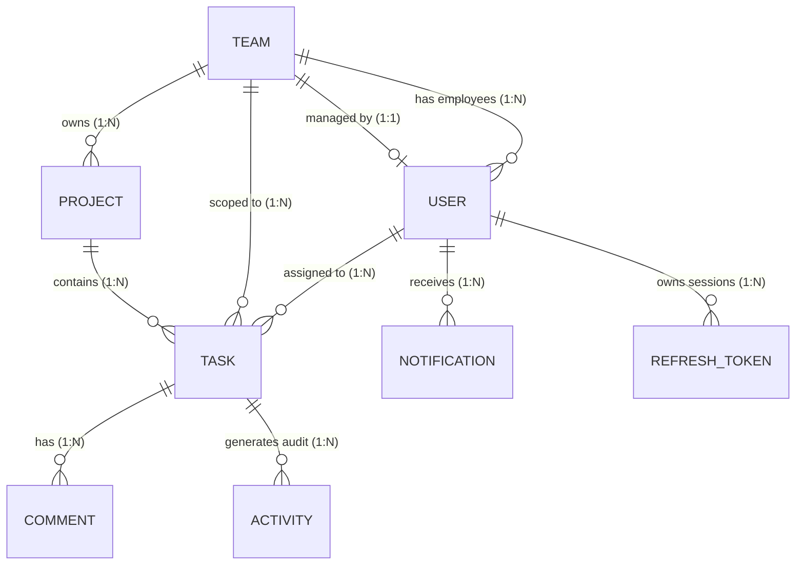

# Database Schema & Data Models — Actowiz Task Management System

## 1. Overview & Entity Relationship Diagram

The persistence layer uses MongoDB managed through Mongoose. The database is normalized into eight core collections designed to support strict role-based scoping, optimistic concurrency, atomic transactional auditing, and notification deduplication.



---

## 2. Entity Schemas

### 2.1 User (`users`)
Represents system actors across the three distinct roles.
```typescript
interface IUser {
  _id: ObjectId;
  name: string;               // trimmed, 2-100 chars
  email: string;              // unique, lowercase, trimmed
  passwordHash: string;       // bcrypt hash (work factor: 12)
  role: 'ADMIN' | 'MANAGER' | 'EMPLOYEE';
  teamId?: ObjectId;          // reference to Team (null for Admin; required for Manager & Employee)
  isActive: boolean;          // default: true (deactivated users cannot log in)
  createdAt: Date;
  updatedAt: Date;
}
```
**Indexes**:
- `{ email: 1 }` (Unique)
- `{ role: 1, teamId: 1 }`
- `{ isActive: 1 }`

---

### 2.2 Team (`teams`)
Represents functional units. Each team has at most one Manager, and each Manager manages at most one team.
```typescript
interface ITeam {
  _id: ObjectId;
  name: string;               // unique, trimmed, 2-100 chars
  description?: string;       // max 500 chars
  managerId?: ObjectId;       // reference to User with role 'MANAGER' (unique)
  createdAt: Date;
  updatedAt: Date;
}
```
**Indexes**:
- `{ name: 1 }` (Unique)
- `{ managerId: 1 }` (Unique, sparse — enforces 1:1 Manager to Team)

---

### 2.3 Project (`projects`)
Projects group tasks and belong strictly to one Team. Includes client metadata and scheduling dates.
```typescript
interface IProject {
  _id: ObjectId;
  name: string;               // trimmed, 2-150 chars
  description?: string;       // max 2000 chars
  client: string;             // trimmed, 2-150 chars (client organization or sponsor)
  startDate: Date;            // project kick-off date
  endDate: Date;              // target project delivery date (must be >= startDate)
  teamId: ObjectId;           // reference to Team (immutable after creation)
  status: 'ACTIVE' | 'ARCHIVED'; // default: 'ACTIVE'
  createdBy: ObjectId;        // reference to User (Admin or Manager)
  createdAt: Date;
  updatedAt: Date;
}
```
**Indexes**:
- `{ teamId: 1, status: 1 }`
- `{ client: 1 }`
- `{ startDate: 1, endDate: 1 }`

---

### 2.4 Task (`tasks`)
The central unit of work. Supports redundant `teamId` for efficient querying, binary-validated attachments, optimistic concurrency control via `__v`, and notification deduplication tracking.
```typescript
interface IAttachment {
  id: string;                 // UUID v4
  filename: string;           // sanitized storage filename (stored on private filesystem)
  originalName: string;       // user-uploaded original filename
  url: string;                // secure download endpoint URL (/api/tasks/:id/attachments/:attachmentId/download)
  mimeType: string;           // validated MIME type verified via binary magic bytes (max 10MB)
  size: number;               // file size in bytes
  uploadedBy: ObjectId;       // reference to User
  uploadedAt: Date;           // default: Date.now
}

interface ITask {
  _id: ObjectId;
  title: string;              // trimmed, 3-200 chars
  description?: string;       // max 5000 chars
  projectId: ObjectId;        // reference to Project
  teamId: ObjectId;           // reference to Team (must equal project.teamId)
  assigneeId: ObjectId;       // reference to User (must be active Employee in teamId)
  status: 'TODO' | 'IN_PROGRESS' | 'IN_REVIEW' | 'DONE'; // default: 'TODO'
  priority: 'LOW' | 'MEDIUM' | 'HIGH' | 'URGENT';        // default: 'MEDIUM'
  dueDate: Date;              // delivery deadline
  completedAt?: Date;         // set permanently when status -> DONE (Terminal)
  attachments: IAttachment[]; // file attachments (max 10MB each, magic-bytes verified)
  lastDueReminderSentAt?: Date; // used to deduplicate 24h due-soon notifications
  createdBy: ObjectId;        // reference to User
  createdAt: Date;
  updatedAt: Date;
  __v: number;                // Mongoose optimistic concurrency version key
}
```
**Indexes**:
- `{ teamId: 1, status: 1 }` (Kanban querying)
- `{ assigneeId: 1, status: 1 }` (Employee personal board)
- `{ projectId: 1, status: 1 }` (Project progress calculation)
- `{ dueDate: 1, status: 1, lastDueReminderSentAt: 1 }` (Due-soon scheduler)

---

### 2.5 Comment (`comments`)
Collaborative discussions on tasks. Historical comments are permanently preserved even if the author is deactivated.
```typescript
interface IComment {
  _id: ObjectId;
  taskId: ObjectId;           // reference to Task
  authorId: ObjectId;         // reference to User
  content: string;            // trimmed, 1-2000 chars
  createdAt: Date;
  updatedAt: Date;
}
```
**Indexes**:
- `{ taskId: 1, createdAt: 1 }`

---

### 2.6 Activity (`activities`)
Server-generated, append-only audit trail of all major task mutations. Created atomically inside the same MongoDB session as the task change. Historical activities cannot be altered or removed.
```typescript
interface IActivity {
  _id: ObjectId;
  taskId: ObjectId;           // reference to Task
  actorId: ObjectId;          // reference to User
  action: 
    | 'TASK_CREATED' 
    | 'TASK_UPDATED' 
    | 'TASK_REASSIGNED' 
    | 'STATUS_CHANGED' 
    | 'REVIEW_REJECTED' 
    | 'COMMENT_ADDED'
    | 'ATTACHMENT_ADDED'
    | 'ATTACHMENT_DELETED';
  details?: {
    isOverride?: boolean;     // true when Manager/Admin advances task on employee's behalf
    [key: string]: unknown;
  };
  oldValue?: string;
  newValue?: string;
  reason?: string;            // Mandatory for REVIEW_REJECTED (trimmed, min 5 chars)
  createdAt: Date;
}
```
**Indexes**:
- `{ taskId: 1, createdAt: -1 }`
- `{ actorId: 1, createdAt: -1 }`

---

### 2.7 Notification (`notifications`)
In-app alerts for assigned employees and managers. Emitted post-commit to ensure transaction success and delivered in real-time via Socket.IO.
```typescript
interface INotification {
  _id: ObjectId;
  userId: ObjectId;           // recipient User
  type: 
    | 'TASK_ASSIGNED' 
    | 'TASK_SUBMITTED_FOR_REVIEW' 
    | 'TASK_REVIEW_APPROVED' 
    | 'TASK_REVIEW_REJECTED' 
    | 'TASK_DUE_SOON'
    | 'COMMENT_ADDED';
  title: string;
  message: string;
  link: string;               // e.g., '/tasks?selected=taskId'
  isRead: boolean;            // default: false
  createdAt: Date;
}
```
**Indexes**:
- `{ userId: 1, isRead: 1, createdAt: -1 }`

---

### 2.8 RefreshToken / Session (`refresh_tokens`)
Tracks active browser sessions to enable cryptographic token rotation and immediate server-side revocation on logout.
```typescript
interface IRefreshToken {
  _id: ObjectId;
  userId: ObjectId;           // reference to User
  tokenHash: string;          // SHA-256 hash of the issued refresh token (never plaintext)
  expiresAt: Date;            // session expiration date
  isRevoked: boolean;         // default: false (true upon logout or reuse detection)
  userAgent?: string;
  ipAddress?: string;
  createdAt: Date;
}
```
**Indexes**:
- `{ tokenHash: 1 }` (Unique)
- `{ userId: 1, isRevoked: 1 }`
- `{ expiresAt: 1 }` (TTL index for automatic deletion)

---

## 3. Organizational Constraints & Lifecycle Rules

### 3.1 Relationships
1. **One Manager per Team**: Enforced by `{ managerId: 1 }` unique index on `teams`.
2. **One Team per Manager**: A user with role `MANAGER` can only manage one team.
3. **Employees Belong to One Team**: Every Employee has a `teamId` pointing to their team.
4. **Task Assignment Integrity**: Tasks can only be assigned to active Employees (`role === 'EMPLOYEE'` and `isActive === true`) belonging to that task's `teamId`.

### 3.2 Safe Lifecycle & Cascading Rules
- **User Deactivation (`isActive: false`)**:
  - The user's active refresh tokens are immediately revoked.
  - Deactivated users cannot log in, make API calls, or connect to Socket.IO.
  - Tasks assigned to a deactivated user remain intact with historical assignee references. The Manager or Admin can reassign them.
  - Historical comments and activity records remain permanently attributed to the deactivated user.
- **Team Changes (Admin Only)**:
  - If an Employee is moved to a new team, any active uncompleted tasks in the old team must be reassigned by the old Manager/Admin first.
- **Project Archiving (`status: 'ARCHIVED'`)**:
  - The project and all child tasks become strictly read-only.
  - Task edits, assignments, comments, attachments, and status transitions are blocked.
- **Task Deletion Scope**:
  - Task deletion is **omitted from initial scope**. All task and audit history is preserved.
  - Any future deletion mechanism will use soft deletion (`isDeleted: true`), deducting soft-deleted tasks from project progress counts.
- **Notification Fallback**:
  - If a task is submitted for review on a team without an assigned Manager, the system delivers the notification to all active Admins so the task is never orphaned.
