# Task Workflow Specification

## 1. Status Values & State Machine

Task status is strictly governed by four sequential states:
- `TODO`: Work not yet started.
- `IN_PROGRESS`: Work is actively being executed.
- `IN_REVIEW`: Work is submitted by the employee awaiting manager or admin review.
- `DONE`: Work has been reviewed and permanently completed (**Terminal State**).

```mermaid
stateDiagram-v2
    [*] --> TODO: Task Created
    TODO --> IN_PROGRESS: Start Task (Assigned Employee; Manager/Admin Override)
    IN_PROGRESS --> IN_REVIEW: Submit for Review (Assigned Employee; Manager/Admin Override)
    IN_REVIEW --> DONE: Approve Review (Manager / Admin only) [TERMINAL]
    IN_REVIEW --> IN_PROGRESS: Reject Review with Mandatory Reason (Manager / Admin only)
    DONE --> [*]
```



> [!IMPORTANT]
> `DONE` is a **strictly terminal state**. Reopening completed tasks is prohibited to preserve historical integrity, sprint completion metrics, and audit records. Once marked `DONE`, a task cannot transition to any other status.

---

## 2. Transition Rules & Role Scopes

### 2.1 Normal Progression vs. Administrative Overrides

1. **Normal Progression**:
   - Assigned Employees execute the day-to-day progression:
     - `TODO -> IN_PROGRESS` (Starting work)
     - `IN_PROGRESS -> IN_REVIEW` (Submitting for review)
   - Employees **cannot** approve (`DONE`), reject (`IN_PROGRESS`), skip stages, or move backwards.
2. **Review Authority**:
   - **Managers** (for their own team) and **Admins** (globally) possess review authority over tasks in `IN_REVIEW`:
     - `IN_REVIEW -> DONE` (Approval)
     - `IN_REVIEW -> IN_PROGRESS` (Rejection with mandatory non-empty reason)
3. **Manager / Admin Progression Overrides**:
   - Managers (within their team) and Admins (globally) retain the ability to advance tasks through `TODO -> IN_PROGRESS` or `IN_PROGRESS -> IN_REVIEW` on behalf of an employee (e.g. employee sudden absence, urgent managerial submission).
   - Whenever an actor other than the assigned employee triggers these transitions, the service flags the operation as an **administrative override** (`isOverride: true`) in the audit `Activity` record, capturing both the actor and the original assignee.

| Current Status | Target Status | Primary Actor | Administrative Override Actor | Conditions & Validations |
|---|---|---|---|---|
| `TODO` | `IN_PROGRESS` | Assigned Employee | Team Manager / Admin | Active project; validates actor scope. Audited as override if not assignee. |
| `IN_PROGRESS` | `IN_REVIEW` | Assigned Employee | Team Manager / Admin | Active project; validates actor scope. Audited as override if not assignee. |
| `IN_REVIEW` | `DONE` | Team Manager / Admin | None (Employees prohibited) | Active project; sets `completedAt = new Date()`. Strictly terminal. |
| `IN_REVIEW` | `IN_PROGRESS` | Team Manager / Admin | None (Employees prohibited) | Active project; **mandatory** trimmed reason (min 5 chars). |

---

## 3. Centralized `TaskWorkflowService` with Atomic Transactions & OCC

All task status transitions in the entire application must pass through:
`TaskWorkflowService.transitionStatus(taskId, targetStatus, actor, clientVersion, rejectionReason?)`

### 3.1 Strengthened Optimistic Concurrency Control (OCC)
To guarantee data consistency without trusting client-supplied old status or state:
1. **Fresh Database Fetch**: The service loads the fresh task and its parent project from MongoDB.
2. **Derive State from DB**: The current status and current `__v` are read directly from the database record. Client-supplied old status is completely ignored.
3. **Project Freeze Check**: Confirms `project.status !== 'ARCHIVED'`. If archived, transition is rejected with `400 Bad Request`.
4. **Fresh Permission & Scoping Check**:
   - If actor is `EMPLOYEE`: Verifies `task.assigneeId.equals(actor._id)`.
   - If actor is `MANAGER`: Verifies `task.teamId.equals(actor.teamId)`.
   - If actor is `ADMIN`: Globally authorized.
   - *Security Guarantee*: Because this check occurs on the freshly loaded document inside the transaction, concurrent reassignments or team changes cannot lead to authorization bypass.
5. **State Machine Validation**: Confirms `currentStatus -> targetStatus` is an allowed transition and `currentStatus !== 'DONE'`.
6. **Rejection Reason Sanitization**:
   - If transitioning `IN_REVIEW -> IN_PROGRESS`, `rejectionReason` is trimmed of whitespace.
   - Validated: `rejectionReason.trim().length >= 5`. Whitespace-only values are rejected with `400 Bad Request`.

### 3.2 Atomic MongoDB Transaction
Task status mutation and `Activity` record creation execute within an atomic MongoDB session:

```typescript
const session = await mongoose.startSession();
session.startTransaction();

try {
  // 1. Atomic OCC findOneAndUpdate using DB-derived expected status and clientVersion
  const updatedTask = await Task.findOneAndUpdate(
    {
      _id: taskId,
      status: dbCurrentStatus,
      __v: clientVersion
    },
    {
      $set: {
        status: targetStatus,
        ...(targetStatus === 'DONE' ? { completedAt: new Date() } : {})
      },
      $inc: { __v: 1 }
    },
    { session, new: true }
  );

  if (!updatedTask) {
    throw new ConflictError('Task was modified concurrently by another user. Please refresh and review.');
  }

  // 2. Insert Activity record in the exact same session
  await Activity.create([
    {
      taskId: updatedTask._id,
      actorId: actor._id,
      action: isRejection ? 'REVIEW_REJECTED' : 'STATUS_CHANGED',
      oldValue: dbCurrentStatus,
      newValue: targetStatus,
      reason: isRejection ? sanitizedReason : undefined,
      details: {
        isOverride: actor.role !== 'EMPLOYEE' && targetStatus !== 'DONE' && !isRejection
      }
    }
  ], { session });

  // 3. Commit transaction
  await session.commitTransaction();
} catch (error) {
  await session.abortTransaction();
  throw error;
} finally {
  session.endSession();
}
```

### 3.3 Post-Commit Real-Time Socket.IO & In-App Notifications
Notifications are dispatched **strictly after** `session.commitTransaction()` succeeds:
- **Persistence First**: Notification is created in MongoDB (`isRead: false`).
- **Real-Time Push**: `socketEmitter.toUser(userId, 'notification:new', notification)` and `socketEmitter.toUser(userId, 'task:status_changed', statusPayload)` emit directly to the user's private WebSocket channel.
- **Notification Failure Isolation**: Notification dispatch is wrapped in a dedicated `try/catch` block. If WebSocket delivery or notification persistence encounters a transient error, the error is logged, and the committed transaction remains permanently valid.

---

## 4. Reliable Notification Routing & Fallback

Notifications for workflow events route as follows:

1. **Submission for Review (`IN_PROGRESS -> IN_REVIEW`)**:
   - Primary: Dispatches `TASK_SUBMITTED_FOR_REVIEW` to the Manager assigned to `task.teamId`.
   - **Fallback (No Manager Assigned)**: If `team.managerId` is unassigned or vacant, the task submission **must still succeed**. The system automatically logs a routing alert and notifies all active `ADMIN` users so the review is not orphaned.
2. **Approval (`IN_REVIEW -> DONE`)**:
   - Dispatches `TASK_REVIEW_APPROVED` directly to `task.assigneeId`, regardless of whether the reviewer was the team Manager or an Admin.
3. **Rejection (`IN_REVIEW -> IN_PROGRESS`)**:
   - Dispatches `TASK_REVIEW_REJECTED` directly to `task.assigneeId`, containing the sanitized `rejectionReason`.
4. **Assignment / Reassignment**:
   - Dispatches `TASK_ASSIGNED` to the new assignee. If reassigned, notifies the previous assignee of the handover.

---

## 5. Archived Projects Policy

When a project is marked `status: 'ARCHIVED'`:
- The project and all its tasks become **strictly read-only**.
- Server-side guards block:
  - Task edits (title, description, priority, due date)
  - Task assignment / reassignment
  - Comment creation
  - Attachment upload and deletion
  - Task status transitions
- Any mutation attempt returns `400 Bad Request` (`"Cannot modify resources belonging to an archived project"`).
- Authorized users (Admin, Manager of team, Assigned Employees) retain full read-only access to view historical tasks, comments, attachments, and activity history.

---

## 6. Scope of Task Deletion & History Preservation

- **Initial Scope**: Task deletion is **not implemented**.
- **Historical Integrity**: All tasks, comments, attachments, and activity logs remain permanently in the database.
- **Future Soft-Deletion Design**: If task deletion is introduced in future iterations:
  - Must be implemented as soft deletion (`isDeleted: true`, `deletedAt: Date`).
  - Hard deletion (`deleteOne`, `deleteMany`) is strictly prohibited to preserve audit trails.
  - Soft-deleted tasks would be deducted from both the numerator and denominator of the project progress calculation.

---

## 7. Review Rejection Validation & Storage

1. **Validation**:
   - Payload field: `rejectionReason: string`.
   - Backend validation: `z.string().trim().min(5, "Rejection reason must be at least 5 characters")`.
   - Pure whitespace (e.g. `"     "`) is rejected with `400 Bad Request`.
2. **Permanent Storage**:
   - The reason is recorded permanently in the append-only `Activity` collection (`action: 'REVIEW_REJECTED'`).
   - The reason is delivered inside the `TASK_REVIEW_REJECTED` notification payload.
   - Ordinary task updates (e.g. updating task description) **never** overwrite or touch historical rejection reasons.

---

## 8. Project Progress Calculation Formula

Project progress is dynamically computed from eligible tasks:

$$\text{Progress \%} = \begin{cases} 0 & \text{if total eligible tasks} = 0 \\ \mathrm{round}\left(\frac{\text{eligible tasks where status} = \text{'DONE'}}{\text{total eligible tasks}} \times 100\right) & \text{otherwise} \end{cases}$$

- **Eligible Tasks Rule**: All non-deleted tasks belonging to the project (`projectId === project._id`).
- When a project has zero tasks, progress is strictly `0%`.
- Calculation is performed dynamically via Mongoose aggregation or query helper to ensure zero stale counters.
